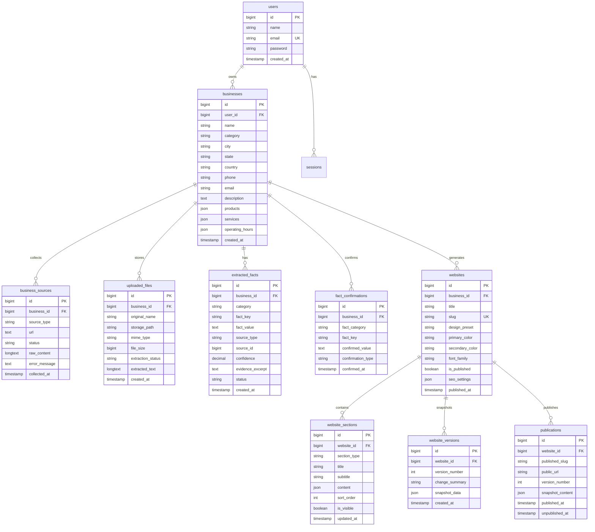

# Database Architecture & Schema Specification (DATABASE.md)
## AI BUILDS MY WEBSITE — MySQL 8.0 Relational Data Model

This document provides a comprehensive technical reference for the database design, tables, data types, foreign keys, indexes, and entity relationships powering **AI Builds My Website**.

---

## 1. Entity-Relationship (ER) Diagram

---

## 2. Table Specifications

### 2.1 `users`
Stores authenticated business owners and SaaS platform users.
- `id`: BIGINT UNSIGNED AUTO_INCREMENT, Primary Key
- `name`: VARCHAR(255), NOT NULL
- `email`: VARCHAR(255), NOT NULL, UNIQUE INDEX
- `email_verified_at`: TIMESTAMP, NULLABLE
- `password`: VARCHAR(255), NOT NULL (Bcrypt hashed)
- `remember_token`: VARCHAR(100), NULLABLE
- `created_at`, `updated_at`: TIMESTAMP

---

### 2.2 `businesses`
Stores the business entity profile created by an authenticated user.
- `id`: BIGINT UNSIGNED AUTO_INCREMENT, Primary Key
- `user_id`: BIGINT UNSIGNED, Foreign Key -> `users(id)` ON DELETE CASCADE
- `name`: VARCHAR(255), NOT NULL
- `category`: VARCHAR(100), NULLABLE
- `city`: VARCHAR(100), NULLABLE
- `state`: VARCHAR(100), NULLABLE
- `country`: VARCHAR(100), DEFAULT 'India'
- `phone`: VARCHAR(50), NULLABLE
- `email`: VARCHAR(255), NULLABLE
- `address`: TEXT, NULLABLE
- `website_url`: VARCHAR(2048), NULLABLE
- `description`: TEXT, NULLABLE
- `products`: JSON, NULLABLE
- `services`: JSON, NULLABLE
- `operating_hours`: JSON, NULLABLE
- `settings`: JSON, NULLABLE
- `created_at`, `updated_at`: TIMESTAMP
- **Indexes:** `user_id` (Foreign Key index)

---

### 2.3 `business_sources`
Tracks public online URLs, social media profiles, and Google Business links added by the owner.
- `id`: BIGINT UNSIGNED AUTO_INCREMENT, Primary Key
- `business_id`: BIGINT UNSIGNED, Foreign Key -> `businesses(id)` ON DELETE CASCADE
- `source_type`: VARCHAR(50), NOT NULL (`website`, `google_business`, `instagram`, `facebook`, `linkedin`, `youtube`, `other`)
- `url`: TEXT, NOT NULL
- `status`: VARCHAR(50), DEFAULT 'pending' (`pending`, `completed`, `failed`, `blocked`)
- `raw_content`: LONGTEXT, NULLABLE (Sanitized extracted text)
- `metadata`: JSON, NULLABLE (HTTP status code, title, headers)
- `error_message`: TEXT, NULLABLE
- `collected_at`: TIMESTAMP, NULLABLE
- `created_at`, `updated_at`: TIMESTAMP
- **Indexes:** `business_id`, `status`

---

### 2.4 `uploaded_files`
Manages uploaded documents (PDF, DOCX, TXT) and business photos.
- `id`: BIGINT UNSIGNED AUTO_INCREMENT, Primary Key
- `business_id`: BIGINT UNSIGNED, Foreign Key -> `businesses(id)` ON DELETE CASCADE
- `original_name`: VARCHAR(255), NOT NULL
- `storage_path`: VARCHAR(500), NOT NULL
- `mime_type`: VARCHAR(100), NOT NULL
- `file_size`: BIGINT UNSIGNED, NOT NULL (in bytes)
- `extraction_status`: VARCHAR(50), DEFAULT 'pending' (`pending`, `completed`, `failed`, `scanned_ocr_required`)
- `extracted_text`: LONGTEXT, NULLABLE
- `error_message`: TEXT, NULLABLE
- `created_at`, `updated_at`: TIMESTAMP
- **Indexes:** `business_id`

---

### 2.5 `extracted_facts`
Stores candidate facts parsed from sources, documents, or initial onboarding forms.
- `id`: BIGINT UNSIGNED AUTO_INCREMENT, Primary Key
- `business_id`: BIGINT UNSIGNED, Foreign Key -> `businesses(id)` ON DELETE CASCADE
- `category`: VARCHAR(50), NOT NULL (`name`, `category`, `phone`, `email`, `address`, `description`, `products`, `services`, `pricing`, `opening_hours`, etc.)
- `fact_key`: VARCHAR(100), NOT NULL
- `fact_value`: TEXT, NOT NULL
- `source_type`: VARCHAR(50), NOT NULL (`manual`, `document`, `website`, `google_business`, `social`)
- `source_id`: BIGINT UNSIGNED, NULLABLE
- `confidence`: DECIMAL(3,2), DEFAULT 1.00
- `evidence_excerpt`: TEXT, NULLABLE (verbatim quote proving the claim)
- `status`: VARCHAR(50), DEFAULT 'unverified' (`unverified`, `confirmed`, `rejected`, `conflicting`, `outdated`)
- `created_at`, `updated_at`: TIMESTAMP
- **Indexes:** `business_id`, `category`, `status`

---

### 2.6 `fact_confirmations`
The **Verified Fact Dictionary** representing the single source of truth for website generation.
- `id`: BIGINT UNSIGNED AUTO_INCREMENT, Primary Key
- `business_id`: BIGINT UNSIGNED, Foreign Key -> `businesses(id)` ON DELETE CASCADE
- `fact_category`: VARCHAR(50), NOT NULL
- `fact_key`: VARCHAR(100), NOT NULL
- `confirmed_value`: LONGTEXT, NOT NULL
- `confirmation_type`: VARCHAR(50), NOT NULL (`direct_confirm`, `edit_confirm`, `conflict_resolution`, `manual_entry`)
- `confirmed_at`: TIMESTAMP, DEFAULT CURRENT_TIMESTAMP
- `created_at`, `updated_at`: TIMESTAMP
- **Unique Constraint:** `business_id` + `fact_category` + `fact_key`

---

### 2.7 `websites`
Core website records connecting business data, design presets, and publication state.
- `id`: BIGINT UNSIGNED AUTO_INCREMENT, Primary Key
- `business_id`: BIGINT UNSIGNED, Foreign Key -> `businesses(id)` ON DELETE CASCADE
- `title`: VARCHAR(255), NOT NULL
- `slug`: VARCHAR(255), NULLABLE, UNIQUE INDEX
- `design_preset`: VARCHAR(50), DEFAULT 'modern_minimal'
- `primary_color`: VARCHAR(20), DEFAULT '#2563eb'
- `secondary_color`: VARCHAR(20), DEFAULT '#0f172a'
- `accent_color`: VARCHAR(20), DEFAULT '#f59e0b'
- `font_family`: VARCHAR(100), DEFAULT 'Instrument Sans'
- `is_published`: BOOLEAN, DEFAULT FALSE
- `published_at`: TIMESTAMP, NULLABLE
- `seo_settings`: JSON, NULLABLE (`seo_title`, `seo_description`, `og_image`)
- `created_at`, `updated_at`: TIMESTAMP
- **Indexes:** `slug` (UNIQUE), `business_id`, `is_published`

---

### 2.8 `website_sections`
Individual modular sections composing a website layout.
- `id`: BIGINT UNSIGNED AUTO_INCREMENT, Primary Key
- `website_id`: BIGINT UNSIGNED, Foreign Key -> `websites(id)` ON DELETE CASCADE
- `section_type`: VARCHAR(50), NOT NULL (`hero`, `about`, `features`, `services`, `products`, `gallery`, `testimonials`, `faq`, `location`, `contact`, `footer`)
- `title`: VARCHAR(255), NULLABLE
- `subtitle`: VARCHAR(500), NULLABLE
- `content`: JSON, NOT NULL
- `sort_order`: INT, DEFAULT 0
- `is_visible`: BOOLEAN, DEFAULT TRUE
- `created_at`, `updated_at`: TIMESTAMP
- **Indexes:** `website_id`, `sort_order`

---

### 2.9 `website_versions`
Immutable historical snapshots preserving full website configuration on each save or publish event.
- `id`: BIGINT UNSIGNED AUTO_INCREMENT, Primary Key
- `website_id`: BIGINT UNSIGNED, Foreign Key -> `websites(id)` ON DELETE CASCADE
- `version_number`: INT, NOT NULL
- `change_summary`: VARCHAR(255), NULLABLE
- `snapshot_data`: JSON, NOT NULL (Entire website and sections state)
- `created_at`, `updated_at`: TIMESTAMP
- **Indexes:** `website_id`, `version_number`

---

### 2.10 `publications`
Publication ledger maintaining audit records and state for every public deployment.
- `id`: BIGINT UNSIGNED AUTO_INCREMENT, Primary Key
- `website_id`: BIGINT UNSIGNED, Foreign Key -> `websites(id)` ON DELETE CASCADE
- `published_slug`: VARCHAR(255), NOT NULL
- `public_url`: VARCHAR(2048), NOT NULL
- `version_number`: INT, NOT NULL
- `snapshot_content`: JSON, NOT NULL
- `published_at`: TIMESTAMP, NOT NULL
- `unpublished_at`: TIMESTAMP, NULLABLE
- `created_at`, `updated_at`: TIMESTAMP
- **Indexes:** `website_id`, `published_slug`
