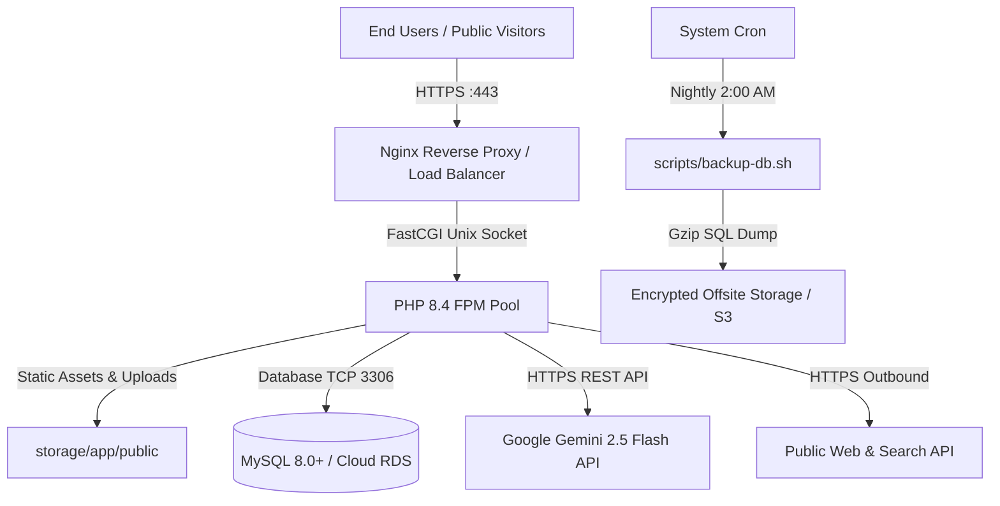

# Production Deployment Guide (DEPLOYMENT.md)
## AI BUILDS MY WEBSITE — Production Infrastructure & Operations Guide

This guide describes the standard production architecture, server provisioning, environment configuration, database management, automated backups, and zero-downtime deployment workflows for **AI Builds My Website**.

---

## 1. Production Architecture Overview



---

## 2. Server Prerequisites & Sizing

### Minimum Recommended Production Specs:
- **Compute**: 2 vCPUs, 4 GB RAM (e.g. AWS `t3.medium`, DigitalOcean Droplet, or Linode)
- **OS**: Ubuntu 22.04 LTS or Ubuntu 24.04 LTS (x86_64 or arm64)
- **Storage**: 40 GB+ NVMe SSD
- **Runtime Stack**:
  - PHP `8.4` (or `8.2+`) CLI & FPM with modules: `pdo_mysql`, `mbstring`, `openssl`, `curl`, `fileinfo`, `zip`, `gd`, `intl`
  - MySQL `8.0+` or MariaDB `10.4+` (or AWS RDS / GCP Cloud SQL)
  - Nginx `1.22+` with HTTP/2 and TLS 1.3
  - Node.js `20.x` or `22.x LTS` & npm `10.x+`
  - Git, Composer `2.x`, Certbot

---

## 3. Server Provisioning & Installation

### Step 1: Install System Dependencies on Ubuntu
```bash
sudo apt update && sudo apt upgrade -y
sudo apt install -y software-properties-common curl git unzip ufw nginx certbot python3-certbot-nginx

# Add PHP 8.4 repository (Ondřej Surý PPA)
sudo add-apt-repository -y ppa:ondrej/php
sudo apt update
sudo apt install -y php8.4-fpm php8.4-cli php8.4-mysql php8.4-mbstring \
    php8.4-xml php8.4-curl php8.4-zip php8.4-gd php8.4-intl php8.4-bcmath

# Install Composer
curl -sS https://getcomposer.org/installer | php
sudo mv composer.phar /usr/local/bin/composer

# Install Node.js 22 LTS
curl -fsSL https://deb.nodesource.com/setup_22.x | sudo -E bash -
sudo apt install -y nodejs
```

### Step 2: Clone Repository & Set Permissions
```bash
sudo mkdir -p /var/www/ai-builds-my-website
sudo chown -R $USER:www-data /var/www/ai-builds-my-website
cd /var/www/ai-builds-my-website

git clone https://github.com/your-username/ai-builds-my-website.git .
```

### Step 3: Configure Permissions
```bash
sudo chown -R www-data:www-data storage bootstrap/cache
sudo chmod -R 775 storage bootstrap/cache
```

---

## 4. Environment & Database Configuration

### Step 1: Bootstrap `.env`
```bash
cp .env.production.example .env
php artisan key:generate
```

Edit `.env` and configure production parameters:
- `APP_ENV=production`
- `APP_DEBUG=false`
- `APP_URL=https://your-domain.com`
- `DB_HOST=127.0.0.1` (or your cloud database endpoint)
- `DB_DATABASE=ai_builds_my_website`
- `DB_USERNAME=your_db_user`
- `DB_PASSWORD=your_secure_password`
- `GEMINI_API_KEY=your_actual_gemini_api_key`
- `SESSION_SECURE_COOKIE=true`
- `LOG_CHANNEL=daily`
- `LOG_LEVEL=info`

### Step 2: Run Database Migrations
```bash
php artisan migrate --force
```

### Step 3: Link Storage
```bash
php artisan storage:link
```

### Step 4: Compile Production Frontend Assets
```bash
npm ci --prefer-offline --no-audit
npm run build
```

### Step 5: Cache Routes, Configuration, and Views
```bash
php artisan config:cache
php artisan route:cache
php artisan view:cache
php artisan event:cache
```

---

## 5. Nginx Web Server Configuration

Create `/etc/nginx/sites-available/ai-builds-my-website`:

```nginx
server {
    listen 80;
    listen [::]:80;
    server_name your-domain.com www.your-domain.com;
    return 301 https://$host$request_uri;
}

server {
    listen 443 ssl http2;
    listen [::]:443 ssl http2;
    server_name your-domain.com www.your-domain.com;

    root /var/www/ai-builds-my-website/public;
    index index.php index.html;

    # SSL Certificates (managed via Certbot)
    ssl_certificate /etc/letsencrypt/live/your-domain.com/fullchain.pem;
    ssl_certificate_key /etc/letsencrypt/live/your-domain.com/privkey.pem;
    include /etc/letsencrypt/options-ssl-nginx.conf;
    ssl_dhparam /etc/letsencrypt/ssl-dhparams.pem;

    # Security Headers
    add_header X-Frame-Options "SAMEORIGIN" always;
    add_header X-Content-Type-Options "nosniff" always;
    add_header X-XSS-Protection "1; mode=block" always;
    add_header Referrer-Policy "strict-origin-when-cross-origin" always;
    add_header Strict-Transport-Security "max-age=31536000; includeSubDomains" always;

    charset utf-8;
    client_max_body_size 20M;

    # Gzip Compression
    gzip on;
    gzip_vary on;
    gzip_proxied any;
    gzip_comp_level 6;
    gzip_types text/plain text/css text/xml application/json application/javascript application/rss+xml image/svg+xml;

    location / {
        try_files $uri $uri/ /index.php?$query_string;
    }

    location = /favicon.ico { access_log off; log_not_found off; }
    location = /robots.txt  { access_log off; log_not_found off; }

    # Static Assets Cache
    location ~* \.(jpg|jpeg|png|gif|ico|css|js|woff|woff2|ttf|svg)$ {
        expires 30d;
        add_header Cache-Control "public, no-transform";
        access_log off;
    }

    # PHP-FPM Handler
    location ~ \.php$ {
        fastcgi_pass unix:/var/run/php/php8.4-fpm.sock;
        fastcgi_param SCRIPT_FILENAME $realpath_root$fastcgi_script_name;
        include fastcgi_params;
        fastcgi_hide_header X-Powered-By;
        fastcgi_read_timeout 60;
    }

    # Deny Hidden Files (.git, .env)
    location ~ /\.(?!well-known).* {
        deny all;
    }
}
```

Enable site and restart Nginx:
```bash
sudo ln -s /etc/nginx/sites-available/ai-builds-my-website /etc/nginx/sites-enabled/
sudo nginx -t
sudo systemctl reload nginx
```

Obtain SSL certificate via Let's Encrypt:
```bash
sudo certbot --nginx -d your-domain.com -d www.your-domain.com
```

---

## 6. Automated Backup & Disaster Recovery

### Automated Nightly Database Backups
A production backup script is provided at [`scripts/backup-db.sh`](file:///D:/ai-builds-my-website/scripts/backup-db.sh). It executes `mysqldump` with `--single-transaction`, `--quick`, and compresses output with `gzip -9`, automatically purging backups older than 14 days.

Set up a daily cron task:
```bash
sudo crontab -e
```
Add the following entry:
```cron
# Run daily MySQL database backup at 2:00 AM UTC
0 2 * * * /var/www/ai-builds-my-website/scripts/backup-db.sh /var/backups/mysql >> /var/log/mysql-backup.log 2>&1
```

### Disaster Recovery Procedure
To restore the database from a backup file, run [`scripts/restore-db.sh`](file:///D:/ai-builds-my-website/scripts/restore-db.sh):
```bash
chmod +x scripts/restore-db.sh
./scripts/restore-db.sh /var/backups/mysql/backup_ai_builds_my_website_YYYYMMDD_HHMMSS.sql.gz
```

---

## 7. Zero-Downtime Deployment Workflow

To deploy code updates smoothly without disrupting live traffic, run [`scripts/deploy.sh`](file:///D:/ai-builds-my-website/scripts/deploy.sh):

```bash
chmod +x scripts/deploy.sh
./scripts/deploy.sh
```

The script automatically:
1. Puts the application into maintenance mode with a bypass token.
2. Pulls code from Git (`origin main --ff-only`).
3. Updates Composer dependencies with `--no-dev --optimize-autoloader`.
4. Compiles production assets with `npm run build`.
5. Runs any new database migrations with `--force`.
6. Refreshes configuration, route, view, and event caches.
7. Restarts queue workers and deactivates maintenance mode.

---

## 8. Production Health & Monitoring

- **Health Endpoint**: The application exposes `/up` returning HTTP `200 OK` for load balancer health probes.
- **Error Telemetry**: Error logs are written to `storage/logs/laravel-YYYY-MM-DD.log`. Monitor in real-time:
  ```bash
  tail -f /var/www/ai-builds-my-website/storage/logs/laravel-$(date +%Y-%m-%d).log
  ```
- **Process Monitoring**: Ensure PHP-FPM and Nginx are monitored by systemd:
  ```bash
  sudo systemctl status php8.4-fpm
  sudo systemctl status nginx
  ```
