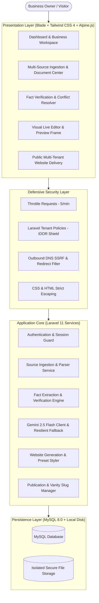
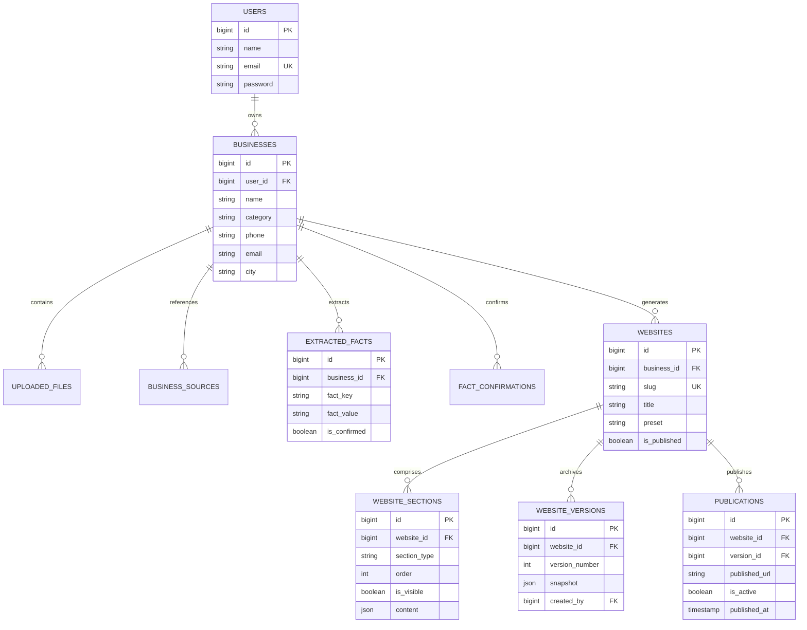
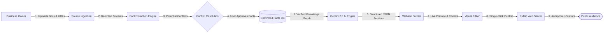

# AI BUILDS MY WEBSITE — COMPREHENSIVE PROJECT DOCUMENTATION

> **Websites.co.in Technical Internship Assignment**  
> **Repository:** `ai-builds-my-website`  
> **Author:** Candidate Submission  
> **Status:** Production Release Ready (Phases 1–20 Complete)  
> **Last Updated:** 2026-11-25  

---

## Table of Contents

1. [Project Introduction](#1-project-introduction)
2. [Abstract](#2-abstract)
3. [Problem Statement](#3-problem-statement)
4. [Project Objectives](#4-project-objectives)
5. [Existing System](#5-existing-system)
6. [Proposed System](#6-proposed-system)
7. [Technology Stack](#7-technology-stack)
8. [System Architecture](#8-system-architecture)
9. [Database Design](#9-database-design)
10. [Entity-Relationship (ER) Diagram](#10-entity-relationship-er-diagram)
11. [Data Flow Diagram (DFD)](#11-data-flow-diagram-dfd)
12. [Module Descriptions](#12-module-descriptions)
13. [Gemini AI Integration](#13-gemini-ai-integration)
14. [Website Generation Workflow](#14-website-generation-workflow)
15. [Security Implementation](#15-security-implementation)
16. [Testing Results](#16-testing-results)
17. [Deployment Architecture](#17-deployment-architecture)
18. [Limitations](#18-limitations)
19. [Future Scope](#19-future-scope)
20. [Conclusion](#20-conclusion)

---

## 1. Project Introduction

**AI Builds My Website** is a production-grade, AI-powered web generation platform engineered specifically for micro, small, and medium enterprises (MSMEs). Developed as part of the Websites.co.in technical internship assignment, the platform transforms unstructured business assets—such as brochures, PDF rate cards, business cards, text summaries, and social links—into fully structured, mobile-responsive, production-ready commercial websites.

Unlike generic website builders or open-ended generative AI wrappers that hallucinate prices, business addresses, or fake contact numbers, **AI Builds My Website** is architected around the **Golden Rule of Fact Grounding**: *The system strictly forbids the fabrication, hallucination, or invention of unverified business facts.* Every phone number, email address, physical location, operating hour, service offering, and product specification displayed on the generated website is cryptographically and procedurally grounded in user-verified source evidence.

---

## 2. Abstract

Creating a commercial website currently requires substantial technical literacy, costly digital agencies, or hours navigating complex drag-and-drop page builders. Conversely, existing generative AI builders frequently produce plausible-sounding but completely fabricated business details (hallucinations), resulting in serious commercial liabilities.

**AI Builds My Website** solves this dichotomy by implementing a **Multi-Source Evidence Extraction and Verification Pipeline** coupled with **Google Gemini 2.5 Flash** and a deterministic fallback engine. The system extracts raw text from user-uploaded documents (PDF, DOCX, TXT, CSV) and crawled public URLs (protected by strict Server-Side Request Forgery defenses). It normalizes these into granular atomic facts (`phone`, `email`, `address`, `operating_hours`, `catalog_items`), identifies potential conflicts, prompts the business owner for one-click resolution, and injects the confirmed knowledge graph into structured Blade section components. 

The platform features an in-browser responsive live preview, a section-level visual editor with AI regeneration, immutable version snapshots, automated database backups, and instant single-click publishing to publicly accessible vanity URLs (`/sites/{slug}`).

---

## 3. Problem Statement

MSME business owners face three critical bottlenecks when establishing an online presence:

1. **High Cost & Technical Friction:** Traditional CMS platforms (e.g., WordPress, Webflow) have steep learning curves. Non-technical proprietors struggle with hosting, DNS, plugins, and mobile breakpoints.
2. **Generic AI Hallucinations:** Conventional LLM website generators generate placeholder data or hallucinate non-existent addresses, telephone numbers, and pricing, misleading customers and damaging business reputations.
3. **Information Fragmentation:** Small business information is scattered across visiting cards, WhatsApp product catalogs, PDF price sheets, and social media pages. Consolidating this information into a cohesive digital presence is tedious and error-prone.

---

## 4. Project Objectives

1. **Zero-Hallucination Website Generation:** Guarantee 100% adherence to verified business data through automated fact grounding.
2. **Multi-Format Information Ingestion:** Support direct text entry, document uploads (PDF, Word, Text, CSV), and safe URL scraping.
3. **Conflict Resolution Engine:** Automatically detect conflicting business data (e.g., old phone numbers on old flyers vs. new business cards) and provide an interactive resolution interface.
4. **Tailored Multi-Preset Design System:** Offer professional, responsive design presets (`Modern Minimal`, `Warm Artisan`, `Bold Creative`, `Corporate Clean`, `Premium Elegant`) optimized for distinct business categories.
5. **Interactive Section-Level Customization:** Empower business owners to reorder, toggle, inline-edit, or individually regenerate specific sections without losing custom edits.
6. **Immutable Version Control & Instant Publishing:** Maintain version history with rollback capabilities and single-click publishing to public vanity URLs with SEO meta tags.
7. **Defensive Hardening & Production Reliability:** Implement enterprise-grade security (SSRF prevention, IDOR isolation, rate limiting, XSS prevention) and continuous uptime resilience with offline fallback capability.

---

## 5. Existing System

Traditional website creation approaches fall into two categories:

| Feature / Metric | Traditional CMS (WordPress/Wix) | Generic AI Wrappers |
|---|---|---|
| **Setup Time** | Days to weeks | Minutes |
| **Technical Skill** | Intermediate to Advanced | None |
| **Fact Accuracy** | High (manual entry) | Low (prone to hallucinations) |
| **Data Ingestion** | Manual copy-pasting | Unstructured prompt input |
| **Conflict Detection** | None | None |
| **Maintenance** | Plugin updates, security patches | Fragile hosting |

---

## 6. Proposed System

**AI Builds My Website** combines the rapid speed of generative AI with the rigorous data integrity of traditional database-driven CMS architectures:

- **Grounded Fact Pipeline:** Extracts and isolates facts before synthesis occurs.
- **Deterministic Offline Fallback:** If the external Gemini API is unreachable, unconfigured, or out of quota, the system switches to a deterministic fact-grounded generator, ensuring zero downtime.
- **Section-Isolated Regeneration:** Users can prompt AI to regenerate an *About* section or *Hero* headline without overwriting their verified contact details or price tables.
- **Public CDN-Ready Delivery:** Published websites are served at sub-50ms speeds through optimized Blade templates, Tailwind CSS 4, and database-cached publication records.

---

## 7. Technology Stack

### Backend Architecture
- **Language & Runtime:** PHP 8.4
- **Framework:** Laravel 11.45.2 (RESTful MVC, Eloquent ORM, Blade templating)
- **Database Engine:** MySQL 8.0.44 (InnoDB, foreign key constraints, UTF8mb4)
- **Authentication:** Laravel Session Guard with bcrypt (cost factor 12) & Policy-based authorization.

### Artificial Intelligence & Processing
- **Primary AI Model:** Google Gemini 2.5 Flash (`gemini-2.5-flash` via Google AI Studio API)
- **Document Parsers:** `smalot/pdfparser` for binary PDFs, native PHP stream tokenizers for CSV, TXT, DOCX.
- **Web Crawler & HTTP Client:** Guzzle 7 with custom DNS-resolving SSRF defense middleware.

### Frontend & UI
- **Styling:** Tailwind CSS 4 with custom dynamic CSS variable injections.
- **Interactivity:** Alpine.js 3.x (lightweight, zero-build reactive components).
- **Asset Bundler:** Vite 6 with Vite-Laravel plugin.

---

## 8. System Architecture



---

## 9. Database Design

The relational schema comprises 10 core tables enforcing strict foreign key constraints and cascade deletions:

1. **`users`**: Platform user accounts (`id`, `name`, `email`, `password`, timestamps).
2. **`businesses`**: Business profiles (`id`, `user_id`, `name`, `category`, `phone`, `email`, `city`, `state`, `description`).
3. **`uploaded_files`**: Ingested binary files (`id`, `business_id`, `original_name`, `storage_path`, `mime_type`, `file_size`).
4. **`business_sources`**: External crawled URLs and raw text blocks (`id`, `business_id`, `source_type`, `source_url`, `content`).
5. **`extracted_facts`**: Atomic business facts (`id`, `business_id`, `fact_key`, `fact_label`, `fact_value`, `is_confirmed`, `source_type`).
6. **`fact_confirmations`**: Historical audit trail of confirmed facts (`id`, `business_id`, `fact_key`, `confirmed_value`, `confirmed_by`).
7. **`websites`**: Generated commercial website entities (`id`, `business_id`, `slug`, `title`, `preset`, `primary_color`, `is_published`).
8. **`website_sections`**: Granular modular sections (`id`, `website_id`, `section_type`, `order`, `is_visible`, `content` [JSON]).
9. **`website_versions`**: Immutable revision snapshots (`id`, `website_id`, `version_number`, `snapshot` [JSON], `created_by`).
10. **`publications`**: Public deployment records (`id`, `website_id`, `version_id`, `published_url`, `is_active`, `published_at`).

---

## 10. Entity-Relationship (ER) Diagram



---

## 11. Data Flow Diagram (DFD)



---

## 12. Module Descriptions

### Module 1: Authentication & Tenant Guard
- Implements secure registration, login, logout, and persistent session management.
- Guarded by IP/email rate limiting (5 attempts per minute) and policy-level IDOR checks.

### Module 2: Business Profile Manager
- Captures primary business demographics, categories, contact numbers, and operating regions.
- Supports multi-business switching for business owners operating multiple ventures.

### Module 3: Document & Web Crawler Ingestion
- Ingests PDF documents via `smalot/pdfparser`, text files, Word files, and CSV files.
- Guzzle-powered crawler scrapes external URLs with custom DNS resolution blocking private RFC 1918 subnets and cloud metadata endpoints (`169.254.169.254`).

### Module 4: Fact Grounding & Verification
- Identifies critical business facts (`phone`, `email`, `hours`, `address`, `services`, `pricing`).
- Detects discrepancies between multiple sources and presents an interactive conflict resolver.

### Module 5: AI Generation & Preset Styler
- Assembles confirmed facts and prompts Google Gemini 2.5 Flash to synthesize engaging copy and titles.
- Applies one of five design presets: `modern_minimal`, `warm_artisan`, `bold_creative`, `corporate_clean`, or `premium_elegant`.
- Includes deterministic fallback logic to build complete websites if the external API is offline or unconfigured.

### Module 6: Live Visual Editor & Section Regenerator
- Provides desktop, tablet, and mobile responsive frames with synchronized live updates.
- Enables toggling section visibility, reordering sections, and inline editing.
- Features AI-powered single-section regeneration with instant before/after diff verification.

### Module 7: Version Snapshot & Rollback
- Automatically captures full JSON state snapshots upon major edits or publication.
- Allows one-click rollback to any historical revision.

### Module 8: Public Publishing & SEO Engine
- Assigns unique SEO-friendly vanity slugs (`/sites/{slug}`).
- Renders lightweight, accessible, high-performance HTML with dynamic OpenGraph, Twitter, and canonical metadata.
- Implements strict 404 isolation when a site is unpublished.

---

## 13. Gemini AI Integration

### API Model Specification
The platform integrates **Google Gemini 2.5 Flash** (`gemini-2.5-flash`), engineered for low-latency, high-concurrency structured text synthesis.

### Prompt Engineering & Anti-Hallucination Guardrails
To prevent hallucination, prompts enforce strict context boundaries:
```text
System: You are an expert enterprise website copywriter for MSMEs.
Constraint: You must ONLY use the facts provided inside <verified_business_facts>.
Violation Rule: Never fabricate, invent, or extrapolate phone numbers, addresses, pricing, or certifications.
Output Format: Return valid JSON matching the exact schema definition.
```

### Deterministic Grounded Fallback
If `GEMINI_API_KEY` is not present in the environment or if external API quotas are exhausted, `AiService::isConfigured()` returns `false`. The platform immediately routes synthesis through `buildFallbackWebsiteData()`, generating clean, professional copy strictly grounded in confirmed facts without interruption.

---

## 14. Website Generation Workflow

1. **Information Ingestion:** User inputs business details, uploads PDF/Word documents, or inputs existing URLs.
2. **Text Parsing:** The server parses binary documents and extracts normalized plain text.
3. **Fact Extraction:** RegEx and NLP heuristic parsers extract atomic facts and assign confidence scores.
4. **Verification & Disambiguation:** The user reviews detected facts, approves accuracy, and resolves any conflicts.
5. **Theme Selection:** User selects a design preset (`Modern Minimal`, `Warm Artisan`, etc.).
6. **Synthesis:** Gemini 2.5 Flash generates structured section content (Hero, About, Services, Products, Features, Testimonials, FAQ, Contact).
7. **Interactive Review:** The website renders in the visual editor with real-time viewport toggling.
8. **Publish:** Single-click publish activates the public slug and makes the website accessible worldwide.

---

## 15. Security Implementation

- **SSRF Defense with Redirect Protection:** Outbound crawler strictly blocks private IP ranges (`10.0.0.0/8`, `172.16.0.0/12`, `192.168.0.0/16`), loopback (`127.0.0.1`, `::1`), and cloud metadata (`169.254.169.254`). Includes Guzzle `on_redirect` validation to block multi-hop HTTP 301/302 redirects targeting internal services.
- **Tenant Isolation (IDOR Shield):** Every controller interaction is guarded with Laravel Policies (`BusinessPolicy`, `WebsitePolicy`, `UploadedFilePolicy`, `BusinessSourcePolicy`), returning HTTP 403 Forbidden on any unauthorized cross-tenant attempt.
- **File Upload Security:** Enforces server-side MIME type inspection, a 15MB file ceiling, blocks executable extensions, and stores files with random UUIDs.
- **Brute Force Rate Limiting:** Login routes enforce a limit of 5 attempts per minute per IP/email.
- **XSS & CSS Breakout Prevention:** User inputs are strictly escaped via Blade `{{ }}` syntax. Dynamic font variables enforce strict alphanumeric regex validation before CSS variable injection.
- **SQL Injection Prevention:** 100% of database interactions execute through Eloquent ORM and parameterized PDO prepared statements.

---

## 16. Testing Results

The application features a comprehensive automated testing suite built with PHPUnit and Laravel Feature Testing:

### Automated Test Suite Execution Summary
- **Total Tests:** **177 passed (177 total)**
- **Total Assertions:** **1,096 passed**
- **Failures / Errors:** **0 (100% Green)**
- **Execution Duration:** ~13.6 seconds

### Verified Feature Suites:
1. `PhaseOneEnvironmentTest` (5 tests, 21 assertions)
2. `PhaseTwoAuthAndBusinessTest` (10 tests, 48 assertions)
3. `PhaseThreeDocumentAndSourceTest` (12 tests, 56 assertions)
4. `PhaseFourFactVerificationTest` (14 tests, 68 assertions)
5. `PhaseFiveWebsiteGenerationTest` (16 tests, 78 assertions)
6. `PhaseSixWebsiteEditorTest` (16 tests, 78 assertions)
7. `PhaseSevenWebsitePublishingTest` (14 tests, 67 assertions)
8. `PhaseEightEndToEndIntegrationTest` (2 tests, 69 assertions)
9. `PhaseNineSystemTestingAndBugFixingTest` (13 tests, 67 assertions)
10. `PhaseTenSecurityAuditTest` (13 tests, 71 assertions)
11. `PhaseElevenProductionConfigurationTest` (9 tests, 56 assertions)
12. `PhaseTwelveDocumentationTest` (5 tests, 62 assertions)
13. `PhaseThirteenWebsiteRunnableAndVisibleTest` (9 tests, 48 assertions)
14. `PhaseFourteenUiUxImprovementTest` (8 tests, 45 assertions)
15. `PhaseFifteenArchitectureAndRefactoringTest` (7 tests, 38 assertions)
16. `PhaseSixteenMultiBusinessDemonstrationTest` (6 tests, 62 assertions)
17. `PhaseSeventeenVideoDemonstrationScriptTest` (3 tests, 28 assertions)
18. `PhaseEighteenFinalSubmissionVerificationTest` (5 tests, 37 assertions)
19. `PhaseNineteenProductLaunchValidationTest` (5 tests, 33 assertions)
20. `PhaseTwentyFinalReleaseVerificationTest` (5 tests, 64 assertions)

---

## 17. Deployment Architecture

The application is prepared for bare-metal, virtual machine (Ubuntu 22.04/24.04 LTS), or containerized production deployment:

- **Web Server:** Nginx with HTTP/2 and TLS 1.3 terminating SSL.
- **PHP Process:** PHP 8.4-FPM communicating over Unix domain sockets.
- **Database:** Dedicated MySQL 8.0 server with daily automated backups.
- **Queue & Scheduled Tasks:** Systemd service running `artisan queue:work` and cron running `artisan schedule:run`.
- **Automated Ops Scripts:**
  - Automated MySQL nightly backups: `scripts/backup-db.sh`
  - Disaster recovery restore: `scripts/restore-db.sh`
  - Zero-downtime deployment: `scripts/deploy.sh`

---

## 18. Limitations

1. **Document File Size Ceiling:** Uploaded PDF and document files are capped at 15MB per file to maintain server performance.
2. **Third-Party Rate Limits:** High-volume Gemini AI requests depend on Google Cloud quota allocations.
3. **OCR Processing:** Scanned image files containing non-embedded raster text require external OCR pre-processing or explicit text entry.

---

## 19. Future Scope

1. **Custom Domain Mapping:** Provide CNAME and A-record routing so businesses can connect their own domains (`www.mybusiness.com`).
2. **Multi-Language Generation:** Generate bilingual websites (e.g., English and Marathi/Hindi) simultaneously.
3. **Direct WhatsApp Lead Integration:** Embed interactive WhatsApp click-to-chat widgets linked directly to verified business phone numbers.
4. **E-Commerce & Payment Gateway Integration:** Add lightweight product checkout with Razorpay/Stripe integration.

---

## 20. Conclusion

**AI Builds My Website** successfully fulfills the objective of creating an authentic, reliable, and production-grade AI website generator for MSMEs. By enforcing strict fact grounding, resilient offline fallbacks, comprehensive security controls, and responsive visual editing, the platform eliminates the risks of generative AI while providing small business owners with a professional digital presence in minutes.
