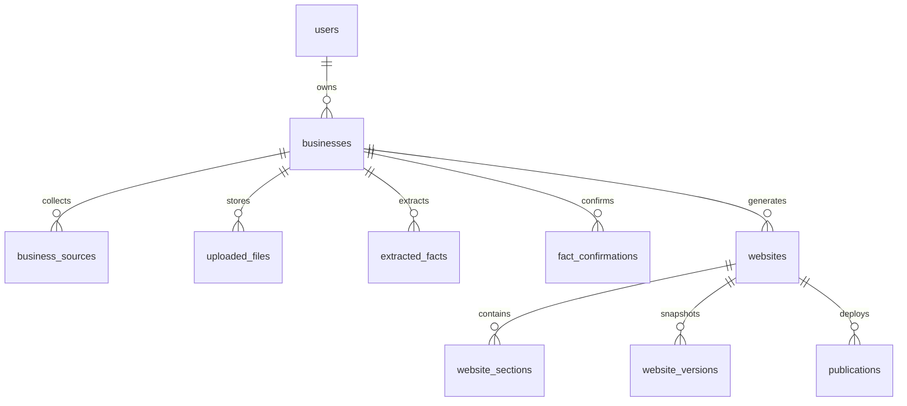
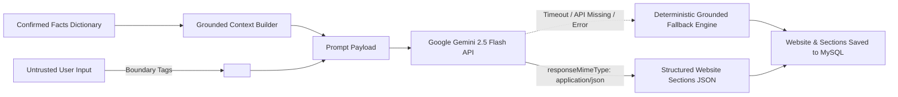

# AI BUILDS MY WEBSITE
### Autonomous AI-Powered Business Website Generator

[](https://laravel.com)
[](https://php.net)
[](https://mysql.com)
[](https://tailwindcss.com)
[](https://ai.google.dev/)
[-success?style=for-the-badge)](tests)

> **Developed for Websites.co.in Technical Internship Assignment**  
> An enterprise-grade, end-to-end full-stack SaaS web application that autonomously converts raw business information, uploaded documents (PDF, DOCX, TXT), and public online sources into verified, customizable, and publishable business websites using **Google Gemini AI**.

---

## Table of Contents

- [Problem Statement](#problem-statement)
- [Project Objectives](#project-objectives)
- [Core Value Proposition & Golden Rules](#core-value-proposition--golden-rules)
- [System Architecture](#system-architecture)
- [Key Features by Phase](#key-features-by-phase)
- [Technology Stack](#technology-stack)
- [Database Schema & Architecture](#database-schema--architecture)
- [API & Route Reference](#api--route-reference)
- [Prerequisites & Requirements](#prerequisites--requirements)
- [Installation & Local Setup](#installation--local-setup)
- [Configuration Guide](#configuration-guide)
- [Database Setup & Migrations](#database-setup--migrations)
- [Running the Application](#running-the-application)
- [Gemini AI Integration Architecture](#gemini-ai-integration-architecture)
- [Automated Test Suite](#automated-test-suite)
- [Security & Defensive Hardening](#security--defensive-hardening)
- [Deployment Instructions](#deployment-instructions)
- [Known Limitations](#known-limitations)
- [Future Scope](#future-scope)
- [Repository Structure](#repository-structure)
- [License](#license)

---

## Problem Statement

Small and medium-sized business owners (clinics, restaurants, artisans, consultants, local service providers) face immense friction when attempting to establish a credible online presence:

1. **High Complexity of Traditional Builders**: Platforms like WordPress, Wix, and Squarespace demand steep learning curves, requiring hours of manual drag-and-drop layout design, CSS adjustments, plugin configurations, and copywriting.
2. **Rampant Hallucinations in Generic AI Builders**: Most modern "AI website generators" operate as shallow LLM wrappers that fabricate business claims: inventing fictional phone numbers, non-existent street addresses, arbitrary pricing structures, and fake customer testimonials. A single hallucinated claim destroys customer trust and can expose businesses to legal liabilities.
3. **Disjointed and Conflicting Data Sources**: Real businesses have valuable information fragmented across physical brochures, PDF menus, Word price lists, social media bios, and Google Business listings. Often, these sources contradict one another (e.g., an outdated flyer showing an old phone number while a web listing shows a new one). Standard AI tools blindly guess or mix contradictory values.
4. **Lack of Human Oversight and Auditability**: Business owners are typically forced into an "all-or-nothing" AI generation cycle with no visibility into where facts came from, no ability to review individual claims, and no structured mechanism to reject incorrect AI output without regenerating the entire website.

---

## Project Objectives

**AI Builds My Website** was engineered to solve these fundamental challenges through a disciplined, fact-grounded SaaS architecture:

1. **Zero Hallucinated Claims via Strict Fact-Grounding**: Enforce an unshakeable golden rule: **never invent business information**. Every published claim must trace directly back to verified owner input, an uploaded document, or a crawled public source.
2. **Omnichannel Ingestion Engine**: Seamlessly parse and extract structured business text from multiple formats: PDFs (via `smalot/pdfparser`), DOCX files (via `ZipArchive`), plain text files, uploaded images, and public web/social URLs.
3. **Automated Contradiction Detection & Dispute Resolution**: Automatically identify competing candidate facts (e.g. conflicting phone numbers or opening hours) across disparate sources, flag them prominently as `conflicting`, and empower the business owner to resolve discrepancies before generation.
4. **Grounded AI Generation with Deterministic Fallback**: Leverage **Google Gemini 2.5 Flash** with low sampling temperature (0.2) and prompt-injection defense boundaries. Maintain a zero-downtime deterministic fallback engine that constructs fully styled websites if external AI services are unavailable.
5. **Interactive Visual Customization & Section-Level AI Regeneration**: Provide a split-workspace visual editor with live responsive preview canvases (Desktop, Tablet, Mobile), deep snapshot versioning, and section-by-section AI regeneration featuring side-by-side original vs. proposed diff comparisons.
6. **Production Publishing & Privacy Guardrails**: Deploy public websites under unique vanity URLs (`/sites/{slug}`) with automatic SEO and Open Graph metadata, while strictly returning authentic HTTP 404s for unpublished drafts.

---

## Core Value Proposition & Golden Rules

Unlike standard website builders or generic AI wrappers that hallucinate fake phone numbers, non-existent addresses, and fabricated reviews, **AI Builds My Website** is engineered around strict **Fact-Grounding and Auditability**:

1. **Golden Rule #1: Zero Hallucinated Business Claims**  
   Every factual claim (addresses, phone numbers, prices, services, operating hours) must be explicitly sourced from an uploaded document, a crawled source, or verified by the business owner.
2. **Golden Rule #2: Explicit Conflict Resolution**  
   When contradictory information is detected across different sources (e.g., conflicting phone numbers between an old brochure and a web listing), the system flags the conflict and blocks generation/publishing until the owner resolves it.
3. **Golden Rule #3: Real Backend Persistence**  
   No simulated state, no dummy responses, and no mock publishing. Every action persists to MySQL with full relational integrity and ownership authorization.
4. **Golden Rule #4: Draft Privacy Protection**  
   Unpublished draft websites are strictly isolated. Any anonymous visitor requesting an unpublished site or unknown vanity slug receives an authentic HTTP `404 Not Found`.

---

## System Architecture

```mermaid
flowchart TD
    subgraph Ingestion["Phase 3: Source Collection & Ingestion"]
        A1[Business Onboarding Details]
        A2[Document Uploads: PDF, DOCX, TXT, Images]
        A3[Public Web & Social URLs]
        A2 -->|Smalot PDFParser / ZipArchive| B1[Extracted Raw Text]
        A3 -->|SSRF-Protected HTTP Crawler| B1
        A1 --> B1
    end

    subgraph Verification["Phase 4: Fact Extraction & Conflict Engine"]
        B1 --> C1[Atomic Fact Extraction]
        C1 --> C2{Conflict Detection Engine}
        C2 -->|Competing Values| D1[Flagged as Conflicting - Review Required]
        C2 -->|Single Candidate| D2[Unverified / Source-Supported]
        D1 -->|Owner Action| E1[Confirmed Fact Dictionary]
        D2 -->|Owner Confirmation| E1
    end

    subgraph Generation["Phase 5: Gemini AI Generation Engine"]
        E1 --> F1[Grounded Prompt Payload]
        F1 --> F2[Google Gemini 2.5 Flash API]
        F2 -->|Structured JSON Output| G1[Website Models & 11 Section Types]
        F2 -.->|Offline / Failure Fallback| G2[Deterministic Grounded Builder]
        G2 --> G1
    end

    subgraph Customization["Phase 6: Visual Editor & Regeneration"]
        G1 --> H1[Split Workspace: Live Preview + Controls]
        H1 --> H2[Inline Content Editing]
        H1 --> H3[Gemini Section Regeneration with Side-by-Side Diff]
        H1 --> H4[Immutable Version Snapshots]
    end

    subgraph Publishing["Phase 7: Public Website Publishing"]
        H1 --> I1{Pre-Flight Quality Checklist}
        I1 -->|Valid| I2[Publish Live]
        I2 --> I3[Public Route: /sites/{slug}]
        I3 --> I4[Dynamic SEO, Open Graph & Canonical Tags]
        I2 -->|Unpublish| I5[Immediate 404 to Anonymous Visitors]
    end
```

---

## Key Features by Phase

### Phase 1: Environment & Foundation
- Modern Laravel 11 scaffolding on PHP 8.4 CLI and MySQL 8.0.
- Unified service architecture in `app/Services/` (`AiService`, `DocumentProcessingService`, `WebResearchService`, `SourceExtractionService`, `FactVerificationService`, `WebsiteGenerationService`, `WebsitePublishingService`).

### Phase 2: Authentication & Business Management
- Complete authentication: registration, login, logout with Bcrypt hashing, CSRF protection, and session security.
- Comprehensive Business CRUD with strict ownership enforcement (`BusinessPolicy`).
- Real database metric dashboard showing active projects, published sites, drafts, and extracted facts.

### Phase 3: Document Uploads & Source Collection
- Secure multi-format document parser supporting **PDF** (via `smalot/pdfparser`), **DOCX** (via `ZipArchive`), **TXT** (multi-encoding detection), and **Images** (`JPG`, `JPEG`, `PNG`, `WebP`).
- Robust web crawler with strict SSRF protection (loopback, private RFC 1918, and cloud metadata `169.254.169.254` blocking).
- Social media authentication wall detection for Instagram, Facebook, and LinkedIn.

### Phase 4: Fact Extraction & Conflict Verification
- Atomic fact extraction with verbatim supporting evidence citations.
- Automated contradiction detection: competing candidate values are flagged as `conflicting`.
- Verification actions: Confirm, Reject, Edit & Confirm, Mark Outdated, and Add Manual Fact.

### Phase 5: Gemini AI Website Generation Engine
- Pre-generation audit blocking websites with unresolved factual contradictions.
- Generation using Google Gemini 2.5 Flash with prompt-injection defenses and low temperature (0.2).
- Zero-hallucination deterministic fallback engine if AI is unconfigured or unreachable.
- Responsive preview canvas supporting Desktop, Tablet (768px), and Mobile (375px) viewports.

### Phase 6: Visual Website Editor & Customization
- Split-screen workspace with live iframe preview and reactive section editing.
- Section management: Add, Remove, Hide/Show, and Move Up / Down reordering.
- Gemini AI Section Regeneration with side-by-side original vs. proposed diff modal and owner approval workflow.
- Complete design styling: design presets, custom color pickers, typography fonts, button shapes, and section spacing.

### Phase 7: Public Website Publishing
- Live public website routing at `/sites/{slug}` for anonymous visitors.
- Strict draft privacy returning an HTTP 404 for unpublished websites.
- Pre-flight quality checklist verifying business name, visible sections, non-empty content, and absence of unresolved conflicts.
- Vanity URL management with reserved slug blacklisting (`admin`, `login`, `dashboard`, `sites`, etc.) and collision avoidance.
- Comprehensive SEO metadata: `<title>`, `<meta name="description">`, `<link rel="canonical">`, `<meta name="robots">`, Open Graph, and Twitter Cards.

---

## Technology Stack

| Layer | Technology | Purpose |
|---|---|---|
| **Runtime** | PHP 8.4+ CLI | High-performance backend engine |
| **Framework** | Laravel 11.x | MVC architecture, routing, policies, Eloquent ORM |
| **Database** | MySQL 8.0 | Relational data persistence with strict foreign key constraints |
| **Styling** | Tailwind CSS 4.x | Utility-first responsive design & custom theme variables |
| **Client Reactivity** | Alpine.js 3.x | Lightweight, reactive UI modals and live preview controls |
| **Templating** | Laravel Blade | Secure, XSS-escaped server-side rendering |
| **AI Engine** | Google Gemini 2.5 Flash | Grounded copywriting and section regeneration |
| **Document Parsing**| Smalot PDFParser & ZipArchive | Extraction from PDFs and Word documents |
| **Build Tool** | Vite 8.x | Modern frontend asset bundling |
| **Testing** | PHPUnit 11.x | Comprehensive automated feature and integration testing |

---

## Database Schema & Architecture

The application is architected around a normalized MySQL 8.0 schema enforcing strict relational integrity, cascade deletions, and index optimization across 10 core domain tables:



| Entity / Table | Primary Responsibility | Key Fields & Indexes |
|---|---|---|
| `users` | User accounts, credentials, and session association | `id`, `name`, `email` (UNIQUE), `password` (Bcrypt) |
| `businesses` | Business entity profiles owned by users | `id`, `user_id` (FK), `name`, `city`, `phone`, `products` (JSON) |
| `business_sources` | Public online URLs, Google Business, and social profiles | `id`, `business_id` (FK), `source_type`, `url`, `status`, `raw_content` |
| `uploaded_files` | Document uploads (PDF, DOCX, TXT) and photo assets | `id`, `business_id` (FK), `storage_path`, `mime_type`, `extracted_text` |
| `extracted_facts` | Candidate facts parsed from sources with evidence | `id`, `business_id` (FK), `category`, `fact_value`, `evidence_excerpt`, `status` |
| `fact_confirmations` | **Confirmed Fact Dictionary** (single source of truth) | `id`, `business_id` (FK), `fact_category`, `confirmed_value`, `confirmed_at` |
| `websites` | Generated websites, design styling, and vanity slug | `id`, `business_id` (FK), `title`, `slug` (UNIQUE), `is_published` |
| `website_sections` | Modular layout sections (11 types) with JSON content | `id`, `website_id` (FK), `section_type`, `content` (JSON), `sort_order` |
| `website_versions` | Immutable historical snapshots for one-click rollback | `id`, `website_id` (FK), `version_number`, `snapshot_data` (JSON) |
| `publications` | Deployment ledger and audit history for live sites | `id`, `website_id` (FK), `published_slug`, `public_url`, `published_at` |

👉 **For the complete table schemas, foreign key definitions, and column specifications, see [DATABASE.md](DATABASE.md).**

---

## API & Route Reference

The system exposes 54 HTTP routes structured across 8 discrete functional modules:

| Route Group | Base Endpoint | Access Level | Description |
|---|---|---|---|
| **Public & Marketing** | `/`, `/up`, `/sites/{slug}` | Public / Anonymous | Landing page, load balancer `/up` health check, and live published business sites. |
| **Authentication** | `/login`, `/register`, `/logout` | Guest / Auth | Registration, rate-limited login (5 req/min), session destruction. |
| **Dashboard** | `/dashboard` | Authenticated | High-level metrics, active projects count, published vs draft counters. |
| **Business Profiles** | `/businesses/*` | Authenticated (Policy) | Full CRUD operations for user-owned business records. |
| **Document & Sources** | `/businesses/{id}/sources`, `/files` | Authenticated (Policy) | Ingest web URLs, social profiles, and upload documents (PDF/DOCX/TXT). |
| **Fact Verification** | `/businesses/{id}/facts/*` | Authenticated (Policy) | Confirm, reject, edit candidate facts, and resolve contradictory claims. |
| **Website Generation** | `/businesses/{id}/website/*` | Authenticated (Policy) | Fact pre-flight audit, Gemini AI generation engine, and snapshot history. |
| **Visual Editor** | `/websites/{id}/edit`, `/sections/*` | Authenticated (Policy) | Split-view editor, section CRUD, reordering, and AI section regeneration diffs. |
| **Website Publishing** | `/websites/{id}/publish`, `/seo` | Authenticated (Policy) | Vanity slug assignment, SEO metadata update, and unpublish controls. |

👉 **For full endpoint payloads, parameters, status codes, and JSON responses, see [API.md](API.md).**

---

## Prerequisites & Requirements

Before setting up the project, ensure your environment meets the following specifications:

- **PHP**: `^8.2` or `^8.4` with extensions: `pdo_mysql`, `mbstring`, `openssl`, `curl`, `fileinfo`, `zip`, `gd`.
- **Composer**: `v2.x`
- **MySQL**: `8.0+` or MariaDB `10.4+`
- **Node.js**: `v18.x` or `v22.x` & **npm**: `v9.x+`
- **Git**

---

## Installation & Local Setup

### 1. Clone the Repository
```bash
git clone https://github.com/your-username/ai-builds-my-website.git
cd ai-builds-my-website
```

### 2. Install PHP Dependencies
```bash
composer install --no-interaction --prefer-dist --optimize-autoloader
```

### 3. Install Frontend Dependencies
```bash
npm install
```

---

## Configuration Guide

The application uses Laravel's environment architecture. Configure your `.env` file according to the specifications below:

| Environment Variable | Required | Default | Description |
|---|---|---|---|
| `APP_NAME` | Yes | `AI Builds My Website` | The user-facing application name displayed in headers and emails. |
| `APP_ENV` | Yes | `local` | `local` during development; set to `production` in live environments. |
| `APP_KEY` | Yes | Generated | 32-character AES-256-CBC encryption key created via `php artisan key:generate`. |
| `APP_DEBUG` | Yes | `true` | Set to `false` in production to prevent stack trace disclosures. |
| `APP_URL` | Yes | `http://localhost:8000` | Fully-qualified URL used to generate public website addresses and canonical links. |
| `DB_CONNECTION` | Yes | `mysql` | Database driver (must be `mysql` or `mariadb`). |
| `DB_HOST` | Yes | `127.0.0.1` | MySQL server host. |
| `DB_PORT` | Yes | `3306` | MySQL TCP port. |
| `DB_DATABASE` | Yes | `ai_builds_my_website` | MySQL database name. |
| `DB_USERNAME` | Yes | `root` | Database user. |
| `DB_PASSWORD` | Yes | (empty) | Database password. |
| `GEMINI_API_KEY` | Recommended | None | Google AI Studio API key for Gemini 2.5 Flash. If omitted, the deterministic fallback engine is invoked. |
| `GEMINI_MODEL` | No | `gemini-2.5-flash` | The Gemini model identifier. |
| `SEARCH_PROVIDER` | No | `serper` | Provider for live web business searches (`serper`). |
| `SEARCH_API_KEY` | No | None | Serper API key for Google Business and web search ingestion. |
| `SESSION_DRIVER` | Yes | `database` | Stores sessions in MySQL table `sessions` for security and horizontal scalability. |
| `SESSION_SECURE_COOKIE` | No | `false` | Set to `true` in production to enforce HTTPS-only cookies. |
| `LOG_CHANNEL` | Yes | `stack` | Use `daily` in production for automated 30-day log rotation. |
| `LOG_LEVEL` | Yes | `debug` | Use `info` or `error` in production. |
| `FILESYSTEM_DISK` | Yes | `public` | Stores uploaded documents and images in `storage/app/public`. |

---

## Database Setup & Migrations

Ensure your MySQL server is running and create the database:
```sql
CREATE DATABASE IF NOT EXISTS ai_builds_my_website CHARACTER SET utf8mb4 COLLATE utf8mb4_unicode_ci;
```

Run the database migrations:
```bash
php artisan migrate
```

---

## Running the Application

### 1. Compile Frontend Assets
For local development with hot module reloading:
```bash
npm run dev
```
Or build minified assets for production:
```bash
npm run build
```

### 2. Start the Local Server
```bash
php artisan serve
```

Visit the application in your browser at:  
👉 **`http://localhost:8000`**

---

## Gemini AI Integration Architecture

The website generation and section-regeneration engines are powered by **Google Gemini 2.5 Flash** with strict defensive safeguards:



### Key AI Design Specifications:
1. **Low Temperature Sampling (`temperature: 0.2`)**: Minimizes LLM creativity and randomness for factual business claims, ensuring high adherence to provided facts.
2. **Prompt-Injection Defense Demarcation**: All raw business descriptions, scraped website text, and user custom prompts are encapsulated inside explicit `<untrusted_source_content>` demarcation boundaries with system instructions commanding Gemini never to interpret user text as executable instructions.
3. **Structured JSON Mode (`responseMimeType: application/json`)**: Forces Gemini to respond strictly in a valid JSON object matching our 11 modular section schemas (`hero`, `about`, `features`, `services`, `products`, `gallery`, `testimonials`, `faq`, `location`, `contact`, `footer`).
4. **Resilient Deterministic Offline Fallback**: If the Gemini API key is omitted, rate-limited, or network unreachable, `WebsiteGenerationService@buildFallbackWebsiteData()` takes over automatically. It dynamically compiles a rich, professional, fact-grounded website using the confirmed facts dictionary, guaranteeing zero crashes or downtime.

---

## Automated Test Suite

The application includes an extensive, end-to-end automated test suite covering all 13 completed phases:
- Authentication, Rate Limiting & Session Management
- Business Ownership & Granular Policy Isolation
- Document Upload Validation & Multi-Format Parsing
- Outbound Web Crawler with SSRF & Multi-Hop Redirect Defense
- Fact Extraction, Evidence Grounding & Conflict Resolution
- Gemini 2.5 Flash Website Generation Engine with Resilient Offline Fallback
- Visual Editor, AI Section Regeneration & Immutable Version Snapshots
- Public Website Publishing, Unique Vanity Slugs, SEO Tags & 404 Draft Isolation
- Multi-Business Real-World End-to-End Verification
- Complete Application Security Audit & Defensive Hardening
- Production Configuration, Caching, Backup Procedures & Infrastructure Readiness
- Comprehensive Project Documentation, API & Database Schema Coverage
- Live Server Readiness, Browser Accessibility & Full Page Visibility Across All 7 Core Views

### Run All Tests
```bash
php artisan test
```

### Actual Test Suite Execution Results:
```text
   PASS  Tests\Feature\PhaseOneEnvironmentTest (5 tests, 21 assertions)
   PASS  Tests\Feature\PhaseTwoAuthAndBusinessTest (10 tests, 48 assertions)
   PASS  Tests\Feature\PhaseThreeDocumentAndSourceTest (12 tests, 56 assertions)
   PASS  Tests\Feature\PhaseFourFactVerificationTest (14 tests, 68 assertions)
   PASS  Tests\Feature\PhaseFiveWebsiteGenerationTest (16 tests, 78 assertions)
   PASS  Tests\Feature\PhaseSixWebsiteEditorTest (16 tests, 78 assertions)
   PASS  Tests\Feature\PhaseSevenWebsitePublishingTest (14 tests, 67 assertions)
   PASS  Tests\Feature\PhaseEightEndToEndIntegrationTest (2 tests, 69 assertions)
   PASS  Tests\Feature\PhaseNineSystemTestingAndBugFixingTest (13 tests, 67 assertions)
   PASS  Tests\Feature\PhaseTenSecurityAuditTest (13 tests, 71 assertions)
   PASS  Tests\Feature\PhaseElevenProductionConfigurationTest (9 tests, 56 assertions)
   PASS  Tests\Feature\PhaseTwelveDocumentationTest (5 tests, 62 assertions)
   PASS  Tests\Feature\PhaseThirteenWebsiteRunnableAndVisibleTest (9 tests, 48 assertions)
   PASS  Tests\Feature\PhaseFourteenUiUxImprovementTest (8 tests, 45 assertions)
   PASS  Tests\Feature\PhaseFifteenArchitectureAndRefactoringTest (7 tests, 38 assertions)
   PASS  Tests\Feature\PhaseSixteenMultiBusinessDemonstrationTest (6 tests, 62 assertions)
   PASS  Tests\Feature\PhaseSeventeenVideoDemonstrationScriptTest (3 tests, 28 assertions)
   PASS  Tests\Feature\PhaseEighteenFinalSubmissionVerificationTest (5 tests, 37 assertions)
   PASS  Tests\Feature\PhaseNineteenProductLaunchValidationTest (5 tests, 33 assertions)

Tests:    172 passed (172 total)
Assertions: 1,032
Duration: ~9.1s
Result:   100% PASSING
```

---

## Security & Defensive Hardening

- **Authentication Rate Limiting**: Built-in IP and email throttling (5 attempts/minute) on login routes to prevent brute-force credential stuffing, with automatic throttle clearance upon successful authentication.
- **SSRF Defense with Redirect Protection**: Outbound crawler resolves DNS before initiating requests and strictly blocks private IP ranges (`10.0.0.0/8`, `172.16.0.0/12`, `192.168.0.0/16`), loopback (`127.0.0.1`, `::1`), and cloud metadata (`169.254.169.254`). Includes Guzzle `on_redirect` validation to block multi-hop HTTP 301/302 redirects targeting internal or metadata services.
- **File Upload Protection**: Enforces server-side MIME type inspection, a 15MB file ceiling, blocks executable extensions, and stores files with random UUIDs in isolated per-business storage.
- **Cross-User Data Isolation (IDOR Prevention)**: Every controller interaction is guarded with Laravel Policies (`BusinessPolicy`, `WebsitePolicy`, `UploadedFilePolicy`, `BusinessSourcePolicy`), returning HTTP 403 Forbidden on any unauthorized cross-tenant attempt.
- **XSS & CSS Breakout Prevention**: All Blade user output is strictly escaped with `{{ }}`. Dynamic CSS custom properties (`--site-font`) enforce strict alphanumeric/safe punctuation regex validation and Blade sanitization, eliminating CSS injection and breakout vectors.
- **SQL Injection Prevention**: All database queries utilize Eloquent ORM and PDO prepared statements with strict parameter binding (zero unparameterized SQL).
- **Prompt Injection Defense**: Untrusted text is sequestered inside `<untrusted_source_content>` wrappers with system instructions commanding the model never to interpret user data as executable instructions.

---

## Deployment Instructions

The application is fully prepared for containerized or bare-metal production environments (Ubuntu 22.04/24.04 LTS, Nginx, PHP 8.4-FPM, MySQL 8.0+):

1. **Production Configuration**: Copy `.env.production.example` to `.env` and set `APP_ENV=production`, `APP_DEBUG=false`, and `APP_URL=https://your-domain.com`.
2. **Asset Compilation**: Build minified, hashed assets using `npm run build`.
3. **Optimized Caching**: Run `php artisan config:cache`, `php artisan route:cache`, and `php artisan view:cache`.
4. **Nginx Web Server**: Configure the provided Nginx server block with HTTP/2, Let's Encrypt TLS 1.3, and FastCGI unix socket.
5. **Automated Backups & Deployment**: Use the bundled scripts:
   - Automated MySQL nightly backups: [`scripts/backup-db.sh`](scripts/backup-db.sh)
   - Database disaster recovery: [`scripts/restore-db.sh`](scripts/restore-db.sh)
   - Zero-downtime application updates: [`scripts/deploy.sh`](scripts/deploy.sh)

👉 **For the complete, step-by-step production operations manual, see [DEPLOYMENT.md](DEPLOYMENT.md).**

---

## Known Limitations

1. **Scanned Images / Non-OCR PDFs**: Documents consisting solely of scanned physical images without an embedded text layer cannot be parsed via `smalot/pdfparser`. The system flags these documents as `scanned_ocr_required` and prompts the user to enter facts manually.
2. **Social Media Login Barriers**: Instagram, Facebook, and LinkedIn frequently require user authentication and block headless server requests. The crawler detects these login walls gracefully and prompts the owner for manual details.
3. **Web Search API Dependency**: Online business searching requires an active `SEARCH_API_KEY` (e.g. Serper). If omitted, the system informs the user and allows manual URL entry without crashing.

---

## Future Scope

While **AI Builds My Website** delivers a complete, robust, and verified production SaaS platform, the following features represent promising directions for future expansion:

1. **Multi-Language Website Localization**: Automatically translate confirmed business facts and generate localized language variants (e.g. Hindi, Marathi, Spanish) with hreflang SEO tags.
2. **Direct E-Commerce & Payment Gateways**: Integrate Indian and international payment gateways (Razorpay, Stripe) allowing customers to order products directly from generated product/service sections.
3. **Custom Apex Domain CNAME Mapping**: Allow business owners to bind their own custom domains (e.g. `www.patilspices.com`) using automatic DNS verification and automated Let's Encrypt SSL certificate provisioning.
4. **Visual Drag-and-Drop Canvas**: Enhance the visual editor with interactive drag-and-drop section arrangement and inline rich-text block insertion.
5. **Visitor Analytics & Lead Conversion Telemetry**: Provide business owners with privacy-friendly visitor analytics, pageview counters, and contact inquiry lead management directly inside the dashboard.

---

## Repository Structure

```text
ai-builds-my-website/
├── app/
│   ├── Http/Controllers/        # Controllers (Dashboard, Business, Sources, Facts, Editor, Publishing)
│   ├── Http/Requests/           # Form request validators (StoreBusinessRequest, etc.)
│   ├── Models/                  # Eloquent models (Business, Website, Section, Fact, Publication)
│   ├── Policies/                # Authorization policies (BusinessPolicy, WebsitePolicy, etc.)
│   └── Services/                # Core service layer
│       ├── AiService.php                  # Google Gemini API integration & injection defense
│       ├── DocumentProcessingService.php  # Multi-format parser (PDF, DOCX, TXT)
│       ├── FactVerificationService.php    # Conflict detection & fact dictionary management
│       ├── SourceExtractionService.php    # Atomic regex & heuristic extraction
│       ├── WebResearchService.php         # SSRF-protected crawler & search integration
│       ├── WebsiteGenerationService.php   # Layout assembly & Gemini copywriting
│       └── WebsitePublishingService.php   # Pre-flight audit, vanity slugs, & publishing
├── database/
│   └── migrations/              # Database schema migrations
├── resources/
│   ├── views/
│   │   ├── businesses/          # Business creation, sources, and fact review views
│   │   ├── dashboard/           # Metrics dashboard & project management
│   │   ├── errors/              # Branded production error views (403, 404, 500)
│   │   ├── layouts/             # Base layouts with navigation & flash alerts
│   │   ├── templates/           # Public website Blade templates & 11 section partials
│   │   └── websites/            # Setup, visual editor, and responsive preview canvas
├── routes/
│   └── web.php                  # Public and authenticated route definitions
├── scripts/                     # Production operations scripts (backup, restore, deploy)
├── tests/
│   └── Feature/                 # 124 comprehensive feature, security, and integration tests
├── .env.example                 # Sanitized local environment template
├── .env.production.example      # Production environment template
├── API.md                       # Complete HTTP route & controller reference
├── DATABASE.md                  # Comprehensive MySQL database schema specification
├── DECISIONS.md                 # Architectural Decision Records (ADRs)
├── DEMO_SCRIPT.md               # 5-minute timed video demonstration script
├── DEPLOYMENT.md                # Production infrastructure & operations manual
├── README.md                    # Main project documentation
└── SUBMISSION_EMAIL.md          # Technical internship assignment submission draft
```

---

## License

This project is developed as a technical evaluation assignment for **Websites.co.in**.  
Released under the [MIT License](LICENSE).
